# Specification: Apple Quest Journey

## 1. Overview & Problem Statement

### Idea
**Apple Quest Journey** is a dual-platform educational system consisting of a **macOS Mentor App** (`AppleQuestJourney` target) and a dedicated **iOS Student Developer App** (`AppleQuestStudents` target). Mentors configure interactive quests centered around Apple frameworks (starting with the **Vision** framework's image/scene classification), attach curated learning resources, and schedule when each quest goes live. Student developers learn by actively experiencing the framework in real time on their iOS devices—accompanied by a real-time **Developer HUD** that exposes underlying API behavior—before unlocking and saving the mentor's learning resources for future reference.

### Problem
Learning Apple technologies and frameworks from documentation alone requires significant effort and often feels abstract to student developers. By letting students first experience what a framework does in a guided, interactive challenge—while inspecting real-time framework outputs—and then immediately connecting that hands-on experience to curated documentation and articles, learning becomes tangible, memorable, and easy to revisit.

---

## 2. Outcomes

### Mentor Outcomes (macOS — `AppleQuestJourney` Target)
1. **Effortless Quest Authoring**: Mentors can create, save as draft, schedule, edit, and delete single-experience quests without writing code.
2. **Valid Vision Configuration**: Mentors can reliably select valid `VNClassifyImageRequest` taxonomy labels—either via a searchable picker of built-in Vision identifiers or by dropping a sample image on macOS to auto-detect and pick from matching labels—and provide an optional hint for students.
3. **Scheduled Delivery**: Mentors control exactly when quests become visible to students via a publish date/time synced through CloudKit.

### Student Developer Outcomes (iOS — `AppleQuestStudents` Target)
1. **Frictionless Access**: Students can browse and play all currently published quests immediately upon opening the app, with zero sign-in or account creation barriers.
2. **Experiential API Learning**: Students experience Apple's `Vision` framework firsthand through a live camera scavenger hunt that renders a **Developer HUD** (showing the active `VNClassifyImageRequest` class, top live `VNClassificationObservation` identifiers, and real-time confidence scores).
3. **Reward-Driven Resource Discovery**: Completing the interactive Vision challenge unlocks curated external URLs (Apple Developer Documentation, WWDC sessions, articles) attached by the mentor.
4. **Permanent Personal Library**: Completed quests and their unlocked learning resources are saved locally on the student's iOS device (via SwiftData) so they remain accessible forever—even offline or if the mentor later edits or deletes the quest from CloudKit.

---

## 3. Boundaries (Scope)

### In Scope (v1)
| Area | Included in v1 |
| :--- | :--- |
| **Targets & Platforms** | Native **macOS** Mentor app (`AppleQuestJourney` target); native **iOS** Student Developer app (`AppleQuestStudents` target); unit test suite (`AppleQuestJourneyTests` target). |
| **Quest Structure** | 1 Quest = Title, Description, Publish Status/Date, 1 Pre-made Experience configuration, and 1..N External URL Learning Resources. |
| **Pre-made Experience** | **Vision Scavenger Hunt (Image/Scene Classification)** using `VNClassifyImageRequest` on a live camera feed. |
| **Experience Parameters** | Target Vision taxonomy label (chosen via searchable taxonomy picker or sample photo drag-and-drop on macOS) + optional text hint. |
| **Developer HUD** | Live camera overlay displaying the Vision request type (`VNClassifyImageRequest`), target identifier, and top live classification observations with confidence percentages. |
| **Mentor Management** | Full CRUD on macOS: Create, Save as Draft, Schedule/Publish (with publish `Date`), Edit, and Delete quests. |
| **Student Navigation** | Tab-based iOS UI in `AppleQuestStudents` with two tabs: **Active Quests** (published quests feed) and **Saved Library** (locally saved completed quests & unlocked resource links). |
| **Cloud Sync** | **CloudKit Public Database** (`iCloud.com.octavianusgandajayapersonalteam.AppleQuestJourney`) shared across `AppleQuestJourney` and `AppleQuestStudents`. |
| **Local Persistence** | **SwiftData** on iOS (`AppleQuestStudents`) for storing completed quests and unlocked learning resources locally on the student's device. |

### Out of Scope (v1)
| Area | Excluded from v1 |
| :--- | :--- |
| **Authentication / Accounts** | No Sign in with Apple, user profiles, cohort codes, or role-based login screens. |
| **Student Telemetry / Grading** | Mentors do not track individual student completion, scores, or analytics in CloudKit. |
| **Multi-Step Quests** | Quests do not chain multiple experiences in a sequence; each quest wraps exactly one experience. |
| **Other Frameworks** | SharePlay, CoreMotion, ARKit, FoundationModels, Text OCR, and Barcode scanning are out of scope for v1 (architecture should allow adding new experience types later). |
| **Rich Media Attachments** | Mentors attach external URLs (Title + URL) only; no hosted video uploads, PDFs, or zip bundles in CloudKit. |
| **Photo Library Fallback on iOS** | The student Vision experience uses the live camera feed only (no static photo picker fallback for gameplay). |

---

## 4. Constraints

1. **Platform & Target Separation**:
   - **`AppleQuestJourney` (macOS App Target)**: Mentor authoring dashboard, Vision taxonomy lookup & sample image classification, CloudKit Public DB read/write.
   - **`AppleQuestStudents` (iOS App Target)**: Student live camera `AVCaptureSession` + `Vision` processing (`NSCameraUsageDescription`), CloudKit Public DB read, local `SwiftData` storage.
   - **`AppleQuestJourneyTests` (Unit Test Target)**: Automated Swift `Testing` suite verifying domain models, CloudKit mapping, Vision taxonomy/classifier logic, Mentor view model, and Student view model/persistence.
2. **CloudKit Public Database Rules**:
   - All quests are stored in the shared container's **Public Database** (`CKContainer.default().publicCloudDatabase`).
   - Because no custom auth flow is built in v1, the macOS Mentor app requires an active iCloud account signed into macOS System Settings to write `CKRecord` items, while the iOS Student app (`AppleQuestStudents`) can query published records publicly without requiring in-app sign-in.
3. **Schedule Enforcement**:
   - Quests saved as **Draft** or with a `publishDate > Date.now` must be **completely hidden** from the Student iOS app (`NSPredicate` filtering `status == "published" AND publishDate <= now`).
4. **Vision Taxonomy Validity**:
   - `VNClassifyImageRequest` can only output identifiers defined in Apple's built-in taxonomy (`VNClassifyImageRequest().supportedIdentifiers()`). The macOS Mentor app must constrain target label selection to valid taxonomy identifiers so mentors never publish an impossible-to-detect target label.
5. **Immutable Local Student Snapshot**:
   - Once a student completes a quest and saves it to their iOS **Saved Library**, a full local snapshot (quest title, description, target label, completion date, and all resource URLs) is persisted in **SwiftData**. Subsequent edits or deletions of that quest in CloudKit by a mentor must **never** delete or overwrite the student's saved local copy.
6. **Concurrency & Architecture**:
   - Use Swift structured concurrency (`async`/`await`) and `@Observable` / `@State` following modern SwiftUI architecture (no Combine).
   - Domain models (`Quest`, `LearningResource`, `QuestStatus`, `ExperienceType`) and repository services (`QuestRepositoryProtocol`, `QuestCKRecordMapper`, `CloudKitQuestRepository`, `InMemoryQuestRepository`) are `nonisolated` and `Sendable` so they interoperate cleanly with `SWIFT_DEFAULT_ACTOR_ISOLATION = MainActor`.
   - Live camera frame analysis (`VNImageRequestHandler`) must run off the main actor to maintain smooth camera preview performance.

---

## 5. Data Model & Architecture

### 5.1 CloudKit Record Schema (`Quest` Record Type in Public DB)
| Field | Type | Description |
| :--- | :--- | :--- |
| `recordName` | `String` (UUID) | Unique identifier of the Quest in CloudKit. |
| `title` | `String` | Display title of the Quest (e.g., *"Spot the Everyday Mug"*). |
| `questDescription` | `String` | Brief overview of what the student will learn and do. |
| `status` | `String` | `"draft"` or `"published"`. |
| `publishDate` | `Date` | The date/time when a `"published"` quest becomes visible to students on iOS. |
| `experienceType` | `String` | `"vision_classification"` (extensible enum raw value). |
| `targetLabel` | `String` | Valid `VNClassifyImageRequest` taxonomy identifier (e.g., `"coffee_cup"`, `"keyboard"`). |
| `hintText` | `String?` | Optional mentor hint shown to students during the camera experience. |
| `resourcesJSON` | `String` (JSON) | Encoded array of `LearningResource` items (`[{ id, title, urlString }]`). |
| `updatedAt` | `Date` | Last modification timestamp. |

### 5.2 Local SwiftData Model on iOS (`SavedQuest`)
| Property | Type | Description |
| :--- | :--- | :--- |
| `questID` | `String` (`@Attribute(.unique)`) | Matches CloudKit `recordName`. |
| `title` | `String` | Snapshot of quest title at time of completion/save. |
| `questDescription` | `String` | Snapshot of quest description. |
| `targetLabel` | `String` | Snapshot of the Vision taxonomy label detected. |
| `detectedConfidence` | `Double` | The confidence score (`0.0`–`1.0`) achieved when the student completed the quest. |
| `completedAt` | `Date` | Timestamp when the student completed the experience. |
| `resources` | `[LearningResource]` | Locally persisted Codable array of `{ id: UUID, title: String, urlString: String }`. |

---

## 6. User Flows

```mermaid
flowchart LR
    subgraph macOS["Mentor App (macOS — AppleQuestJourney)"]
        M1["Create / Edit Quest"] --> M2["Pick Vision Label (Search or Drop Photo)"]
        M2 --> M3["Add Optional Hint & Resource URLs"]
        M3 --> M4["Save as Draft OR Schedule Publish Date"]
    end

    M4 -->|SyncsCKRecord| CK[("CloudKit Public DB")]

    subgraph iOS["Student App (iOS — AppleQuestStudents)"]
        CK -->|Fetch where status == published & publishDate <= now| S1["Active Quests Tab"]
        S1 --> S2["Launch Live Camera Vision Hunt"]
        S2 --> S3["Inspect Live Developer HUD & Match Target Label"]
        S3 --> S4["Unlock Learning Resource URLs"]
        S4 -->|Persist Snapshot| S5[("Local SwiftData: Saved Library Tab")]
    end
```

---

## 7. Testable Requirements

### 7.1 Mentor App (macOS — `AppleQuestJourney`) — Quest Authoring & CRUD
| ID | Requirement | Acceptance Criteria (Testable Verification) |
| :--- | :--- | :--- |
| **REQ-M01** | **Create & Save Draft Quest** | **Given** a mentor fills in a title, description, target Vision label, and at least 1 valid URL resource, **When** they choose "Save as Draft", **Then** the quest is saved to CloudKit with `status == "draft"` and appears under the Drafts section on macOS. |
| **REQ-M02** | **Schedule / Publish Quest** | **Given** a mentor configures a valid quest and selects a publish date/time (immediate or future), **When** they click "Publish / Schedule", **Then** the quest is saved with `status == "published"` and the specified `publishDate`. |
| **REQ-M03** | **Edit Existing Quest** | **Given** an existing draft, scheduled, or published quest on macOS, **When** the mentor modifies any field (title, description, target label, hint, resources, or publish date) and saves, **Then** the corresponding `CKRecord` in CloudKit updates to reflect the changes. |
| **REQ-M04** | **Delete Existing Quest** | **Given** an existing quest in the macOS app, **When** the mentor confirms deletion, **Then** the `CKRecord` is removed from CloudKit Public Database and disappears from the macOS list. |
| **REQ-M05** | **Form Validation** | **Given** a mentor is authoring a quest, **When** the title is empty, no target Vision label is selected, or a learning resource URL fails `URL` validation (must be `http`/`https`), **Then** the Save/Publish action is disabled with clear inline validation feedback. |

### 7.2 Mentor App (macOS — `AppleQuestJourney`) — Vision Taxonomy Picker & Photo Auto-Suggestion
| ID | Requirement | Acceptance Criteria (Testable Verification) |
| :--- | :--- | :--- |
| **REQ-M06** | **Searchable Vision Taxonomy Picker** | **Given** the mentor is configuring the Vision Scavenger Hunt experience, **When** they search the label picker, **Then** only identifiers returned by `VNClassifyImageRequest().supportedIdentifiers()` matching the search query are selectable. |
| **REQ-M07** | **Sample Photo Drop for Label Auto-Suggestion** | **Given** the mentor drags and drops (or selects) an image file in the macOS Quest Editor, **When** `VNClassifyImageRequest` finishes analyzing the image, **Then** the top detected taxonomy labels (with confidence percentages) are displayed as one-click chips to set the quest's `targetLabel`. |
| **REQ-M08** | **Optional Mentor Hint** | **Given** the mentor enters text in the optional Hint field (e.g., *"Look around the pantry!"*), **When** the quest is saved, **Then** `hintText` is stored with the quest; if left blank, `hintText` is `nil`. |

### 7.3 Student App (iOS — `AppleQuestStudents`) — Quest Discovery & Scheduling Visibility
| ID | Requirement | Acceptance Criteria (Testable Verification) |
| :--- | :--- | :--- |
| **REQ-S01** | **Zero-Login Launch** | **Given** a student launches the iOS app (`AppleQuestStudents`) for the first time, **When** the app opens, **Then** it lands directly on the `TabView` (**Active Quests** and **Saved Library**) without presenting any login or onboarding gate. |
| **REQ-S02** | **Published Quests Filtering** | **Given** CloudKit contains Draft quests, Published quests with `publishDate > Date.now`, and Published quests with `publishDate <= Date.now`, **When** the Student iOS app fetches quests in the **Active Quests** tab, **Then** *only* quests with `status == "published"` and `publishDate <= Date.now` are displayed; future and draft quests are completely hidden. |
| **REQ-S03** | **Locked Resources Before Completion** | **Given** a student selects an uncompleted quest from **Active Quests**, **When** viewing the quest detail screen prior to completing the experience, **Then** the attached learning resource URLs are hidden/locked until the Vision experience is completed. |

### 7.4 Student App (iOS — `AppleQuestStudents`) — Live Camera Vision Scavenger Hunt & Developer HUD
| ID | Requirement | Acceptance Criteria (Testable Verification) |
| :--- | :--- | :--- |
| **REQ-S04** | **Live Camera Classification** | **Given** a student starts the Vision Scavenger Hunt experience and grants camera access, **When** the live camera feed runs, **Then** frames are continuously analyzed via `VNClassifyImageRequest` and compared against the quest's `targetLabel`. |
| **REQ-S05** | **Real-Time Developer HUD Overlay** | **Given** the live camera experience is active, **When** `VNClassifyImageRequest` produces observations, **Then** the on-screen Developer HUD displays: (1) the API class name (`VNClassifyImageRequest`), (2) the target taxonomy identifier being sought, and (3) the top 3 live `VNClassificationObservation` identifiers with real-time confidence percentages. |
| **REQ-S06** | **Mentor Hint Display** | **Given** a quest has a non-empty `hintText`, **When** the student is in the live camera experience and taps the "Hint" button (or views the prompt banner), **Then** the mentor's `hintText` is displayed on screen; if `hintText` is `nil`, no hint control is shown. |
| **REQ-S07** | **Target Detection & Experience Completion** | **Given** the student points the camera at an object, **When** `VNClassifyImageRequest` outputs an observation whose `identifier == quest.targetLabel` with confidence meeting the target threshold (e.g., `>= 0.70`), **Then** the experience triggers a completion state, unlocks the quest's learning resources, and persists the completed quest locally. |

### 7.5 Student App (iOS — `AppleQuestStudents`) — Resource Unlocking, Local Persistence & Edge Cases
| ID | Requirement | Acceptance Criteria (Testable Verification) |
| :--- | :--- | :--- |
| **REQ-S08** | **Unlock & Open External URLs** | **Given** a student has completed a quest, **When** viewing the unlocked learning resources in either the completion screen or the **Saved Library** tab, **Then** all mentor-provided URLs are visible and tapping any resource opens the valid URL. |
| **REQ-S09** | **Local Persistence via SwiftData** | **Given** a student completes a quest on iOS, **When** the quest is saved, **Then** a `SavedQuest` snapshot (including title, description, target label, achieved confidence, completion date, and all resource URLs) is stored in local `SwiftData` and appears in the **Saved Library** tab. |
| **REQ-S10** | **Resilience to Mentor Edits/Deletions** | **Given** a student has completed and saved Quest A locally on iOS, **When** a mentor subsequently edits or deletes Quest A in CloudKit on macOS, **Then** Quest A and all of its unlocked learning resource URLs remain intact and accessible in the student's **Saved Library** tab. |
| **REQ-S11** | **Offline Saved Library Access** | **Given** the student's iOS device has no internet connection, **When** the student opens the **Saved Library** tab, **Then** all previously completed quests and their saved resource metadata load from local `SwiftData` without errors. |
| **REQ-S12** | **Replay Completed Experience** | **Given** a quest has already been completed, **When** the student opens that quest again, **Then** they can both view the unlocked resources immediately and choose to replay the live camera Vision experience. |
