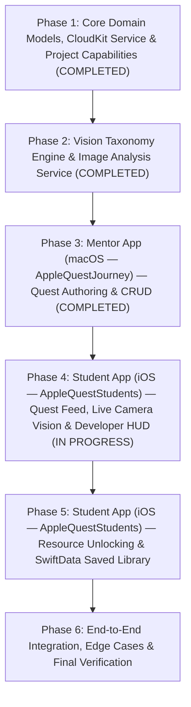

# v1 Development Plan: Apple Quest Journey

This plan translates [spec.md](file:///Users/octavianus/Desktop/Project/AppleQuestJourney/spec.md) into sequential **Development Phases**, **Concrete Development Tasks**, and **Verification Gates** across the **macOS Mentor target (`AppleQuestJourney`)**, the **iOS Student target (`AppleQuestStudents`)**, and the **Unit Test target (`AppleQuestJourneyTests`)**.

---

## Phase Overview

---

## Phase 1: Core Domain Models, CloudKit Service & Project Capabilities ✅

**Goal**: Establish the shared domain layer (`Quest`, `LearningResource`, `QuestValidator`), CloudKit Public Database mapping (`QuestRepositoryProtocol`, `CloudKitQuestRepository`, `InMemoryQuestRepository`), and target entitlements/Info.plist permissions (`CloudKit` + `NSCameraUsageDescription`) across both `AppleQuestJourney` (macOS) and `AppleQuestStudents` (iOS).

### [x] Task 1.1: Configure Project Capabilities & Permissions (Completed)
- **Scope**:
  - [x] Enable **iCloud / CloudKit** capability (`com.apple.developer.icloud-services` = `CloudKit`, container `iCloud.com.octavianusgandajayapersonalteam.AppleQuestJourney`) on both `AppleQuestJourney` and `AppleQuestStudents` targets via [`AppleQuestJourney.entitlements`](file:///Users/octavianus/Desktop/Project/AppleQuestJourney/AppleQuestJourney/AppleQuestJourney.entitlements).
  - [x] Add `INFOPLIST_KEY_NSCameraUsageDescription` to `AppleQuestStudents` (and `AppleQuestJourney`) target build settings so the iOS Student app can capture live camera frames for the Vision Scavenger Hunt.
  - [x] Configure the unit test target (`AppleQuestJourneyTests`) using the Swift `Testing` framework.
- **Verification to Advance**:
  - [x] `BuildProject` succeeds on both `AppleQuestJourney` (macOS) and `AppleQuestStudents` (iOS) schemes with zero errors.

### [x] Task 1.2: Implement Shared Domain Models & Validation Logic (Completed)
- **Requirements Covered**: `REQ-M05`, `REQ-M08`, Section 5.1 of [spec.md](file:///Users/octavianus/Desktop/Project/AppleQuestJourney/spec.md#L85-L98)
- **Concrete Files & Types**:
  - [x] [`AppleQuestJourney/Models/Quest.swift`](file:///Users/octavianus/Desktop/Project/AppleQuestJourney/AppleQuestJourney/Models/Quest.swift) & [`AppleQuestStudents/Models/Quest.swift`](file:///Users/octavianus/Desktop/Project/AppleQuestJourney/AppleQuestStudents/Models/Quest.swift):
    - `QuestStatus` enum (`draft`, `published`)
    - `ExperienceType` enum (`visionClassification = "vision_classification"`)
    - `LearningResource` struct (`id: UUID`, `title: String`, `urlString: String`, computed `validURL: URL?` checking `http`/`https` scheme and non-empty host)
    - `Quest` struct (`id: String`, `title: String`, `questDescription: String`, `status: QuestStatus`, `publishDate: Date`, `experienceType: ExperienceType`, `targetLabel: String`, `hintText: String?`, `resources: [LearningResource]`, `updatedAt: Date`)
    - `QuestValidator` utility validating non-empty title, valid taxonomy label, and at least one valid `http`/`https` `LearningResource` (`REQ-M05`).
- **Verification to Advance**:
  - [x] `XcodeRefreshCodeIssuesInFile` reports 0 diagnostics in `Models/Quest.swift`.
  - [x] Unit tests ([`QuestValidationTests.swift`](file:///Users/octavianus/Desktop/Project/AppleQuestJourney/AppleQuestJourneyTests/QuestValidationTests.swift)) verify:
    1. Empty title or empty target label fails validation (`REQ-M05`).
    2. Malformed URLs (e.g., `"not-a-url"`, `"ftp://example.com"`) fail validation (`REQ-M05`).
    3. Blank `hintText` normalizes to `nil` (`REQ-M08`).
    4. `LearningResource` JSON encoding/decoding round-trips losslessly.

### [x] Task 1.3: Implement CloudKit Public Database Service & Repository Protocol (Completed)
- **Requirements Covered**: `REQ-M01`, `REQ-M02`, `REQ-M03`, `REQ-M04`, `REQ-S02`
- **Concrete Files & Types**:
  - [x] [`AppleQuestJourney/Services/QuestRepository.swift`](file:///Users/octavianus/Desktop/Project/AppleQuestJourney/AppleQuestJourney/Services/QuestRepository.swift) & [`AppleQuestStudents/Services/QuestRepository.swift`](file:///Users/octavianus/Desktop/Project/AppleQuestJourney/AppleQuestStudents/Services/QuestRepository.swift):
    - Protocol `QuestRepositoryProtocol` (`fetchAllQuestsForMentor()`, `fetchPublishedQuestsForStudent(at now: Date)`, `saveQuest(_:)`, `deleteQuest(id:)`) to support both live CloudKit and deterministic in-memory testing.
    - `QuestCKRecordMapper` & `CloudKitQuestRepository`: Maps `Quest` <-> `CKRecord` (`recordType = "Quest"`) in `CKContainer.default().publicCloudDatabase`.
    - Enforces student visibility filtering (`status == "published" && publishDate <= now`) so drafts and future-scheduled quests are completely hidden (`REQ-S02`).
    - `InMemoryQuestRepository`: Actor-isolated mock/preview implementation for SwiftUI Previews and unit tests.
- **Verification to Advance**:
  - [x] Unit tests ([`QuestRepositoryTests.swift`](file:///Users/octavianus/Desktop/Project/AppleQuestJourney/AppleQuestJourneyTests/QuestRepositoryTests.swift)) verify:
    1. `CKRecord` serialization/deserialization preserves all `Quest` fields (`REQ-M01`, `REQ-M03`).
    2. `fetchPublishedQuestsForStudent(at:)` excludes drafts (`status == .draft`) and future quests (`publishDate > now`), returning only active published quests (`REQ-S02`).
    3. Deleting a quest removes it from the repository (`REQ-M04`).

---

## Phase 2: Vision Taxonomy Engine & Image Analysis Service ✅

**Goal**: Build the `Vision` framework integration shared by `AppleQuestJourney` on macOS (taxonomy lookup + static image drop auto-suggestion) and `AppleQuestStudents` on iOS (real-time camera frame classification + confidence tracking).

### [x] Task 2.1: Implement Vision Taxonomy Catalog & Static Image Classifier (Completed)
- **Requirements Covered**: `REQ-M06`, `REQ-M07`
- **Concrete Files & Types**:
  - [x] [`AppleQuestJourney/Services/VisionClassifierService.swift`](file:///Users/octavianus/Desktop/Project/AppleQuestJourney/AppleQuestJourney/Services/VisionClassifierService.swift) & [`AppleQuestStudents/Services/VisionClassifierService.swift`](file:///Users/octavianus/Desktop/Project/AppleQuestJourney/AppleQuestStudents/Services/VisionClassifierService.swift):
    - `VisionObservationItem` struct (`identifier`, `confidence` 0.0–1.0, `confidencePercentageText`).
    - `supportedTaxonomyLabels() -> [String]`: Calls `VNClassifyImageRequest().supportedIdentifiers()` to retrieve Apple's built-in taxonomy identifiers (`REQ-M06`).
    - `searchTaxonomyLabels(query: String) -> [String]`: Case-insensitive filtering and relevance sorting over valid taxonomy identifiers.
    - `classifyStaticImage(cgImage: CGImage) async throws -> [VisionObservationItem]` & `classifyImageData(_: Data)`: Runs `VNClassifyImageRequest` off the main actor and returns the top observations (`identifier`, `confidence` 0.0–1.0) so mentors can drop a photo on macOS and click a suggested label (`REQ-M07`).
    - `rankObservations(_:maxResults:minimumConfidence:)` & `matchingObservation(in:targetLabel:threshold:)` helpers for sorting and target label threshold verification.
- **Verification to Advance**:
  - [x] `XcodeRefreshCodeIssuesInFile` shows 0 issues in `Services/VisionClassifierService.swift`.
  - [x] Unit tests ([`VisionTaxonomyTests.swift`](file:///Users/octavianus/Desktop/Project/AppleQuestJourney/AppleQuestJourneyTests/VisionTaxonomyTests.swift)) verify:
    1. `supportedTaxonomyLabels()` returns a non-empty list of valid Vision identifiers (`REQ-M06`).
    2. `searchTaxonomyLabels(query:)` only returns identifiers present in `supportedTaxonomyLabels()` (`REQ-M06`).
    3. `classifyStaticImage(cgImage:)` executes asynchronously and returns observations sorted by descending confidence (`REQ-M07`).

---

## Phase 3: Mentor App (macOS — `AppleQuestJourney`) — Quest Authoring & CRUD ✅

**Goal**: Build the native macOS Mentor interface in `AppleQuestJourney` for managing quests (Drafts, Scheduled, Published), searching or auto-detecting Vision taxonomy labels via drag-and-drop image analysis, attaching external URLs, and publishing to CloudKit.

### [x] Task 3.1: Mentor Dashboard & NavigationSplitView State Management (Completed)
- **Requirements Covered**: `REQ-M01`, `REQ-M02`, `REQ-M03`, `REQ-M04`
- **Concrete Files & Types**:
  - [x] [`AppleQuestJourney/Features/Mentor/MentorViewModel.swift`](file:///Users/octavianus/Desktop/Project/AppleQuestJourney/AppleQuestJourney/Features/Mentor/MentorViewModel.swift) (`@Observable @MainActor`):
    - Manages quest list grouped/filtered by **All**, **Drafts**, **Scheduled** (`status == .published && publishDate > now`), and **Published Live** (`status == .published && publishDate <= now`).
    - Provides async actions: `loadQuests()`, `saveAsDraft(_:)`, `publishQuest(_:publishDate:)`, `deleteQuest(_:)`.
  - [x] [`AppleQuestJourney/Features/Mentor/MentorDashboardView.swift`](file:///Users/octavianus/Desktop/Project/AppleQuestJourney/AppleQuestJourney/Features/Mentor/MentorDashboardView.swift) (`#if os(macOS)`):
    - 2-column `NavigationSplitView` showing status filter header, searchable quest list with status badges & publish dates, and the detail/editor pane.
- **Verification to Advance**:
  - [x] Unit tests ([`MentorViewModelTests.swift`](file:///Users/octavianus/Desktop/Project/AppleQuestJourney/AppleQuestJourneyTests/MentorViewModelTests.swift)) verify state transitions for creating a draft (`REQ-M01`), scheduling a future quest (`REQ-M02`), editing an existing quest (`REQ-M03`), and deleting a quest (`REQ-M04`).
  - [x] `RenderPreview` on `MentorDashboardView` renders cleanly on macOS.

### [x] Task 3.2: Mentor Quest Editor with Vision Taxonomy Picker & Photo Drop Zone (Completed)
- **Requirements Covered**: `REQ-M05`, `REQ-M06`, `REQ-M07`, `REQ-M08`
- **Concrete Files & Types**:
  - [x] [`AppleQuestJourney/Features/Mentor/QuestEditorView.swift`](file:///Users/octavianus/Desktop/Project/AppleQuestJourney/AppleQuestJourney/Features/Mentor/QuestEditorView.swift) (`#if os(macOS)`):
    - Form inputs for `title`, `questDescription`, `publishDate` (`DatePicker`), and optional `hintText` (`REQ-M08`).
    - **Vision Target Label Selector**:
      - Searchable taxonomy picker bound to `VisionClassifierService.supportedTaxonomyLabels()` (`REQ-M06`).
      - **Sample Photo Drop Zone** (`.dropDestination(for: Data.self)` & `.fileImporter`): Mentors drop or choose a sample photo to run `classifyImageData(_:)` / `classifyStaticImage(cgImage:)` and display top detected labels with confidence badges as one-click chips that populate `targetLabel` (`REQ-M07`).
    - **Learning Resources Editor**:
      - Dynamic list to add/remove `LearningResource` items (`title` + `urlString`) with live URL validation indicators (`REQ-M05`).
    - Action bar with **Save as Draft** and **Publish / Schedule** buttons (disabled until `QuestValidator.isValid(quest)` is true).
- **Verification to Advance**:
  - [x] `BuildProject` for macOS target succeeds with 0 errors.
  - [x] `RenderPreview` on `QuestEditorView` and `MentorDashboardView` verifies layout, validation states, and suggested label chips.

---

## Phase 4: Student App (iOS — `AppleQuestStudents`) — Quest Feed, Live Camera Vision & Developer HUD

**Goal**: Build the iOS Student experience in the `AppleQuestStudents` target starting with zero-login tab navigation, active published quest browsing, and the real-time camera `VNClassifyImageRequest` scavenger hunt with the live **Developer HUD**.

### [x] Task 4.1: Student Tab Navigation & Active Quests Feed in `AppleQuestStudents` (Completed)
- **Requirements Covered**: `REQ-S01`, `REQ-S02`, `REQ-S03`, `REQ-S12`
- **Concrete Files & Types**:
  - [x] [`AppleQuestStudents/ContentView.swift`](file:///Users/octavianus/Desktop/Project/AppleQuestJourney/AppleQuestStudents/ContentView.swift) & [`AppleQuestStudents/Features/Student/StudentRootView.swift`](file:///Users/octavianus/Desktop/Project/AppleQuestJourney/AppleQuestStudents/Features/Student/StudentRootView.swift):
    - Zero-login `TabView` with two tabs: **Active Quests** and **Saved Library** (`REQ-S01`).
  - [x] [`AppleQuestStudents/Features/Student/ActiveQuestsViewModel.swift`](file:///Users/octavianus/Desktop/Project/AppleQuestJourney/AppleQuestStudents/Features/Student/ActiveQuestsViewModel.swift) & [`AppleQuestStudents/Features/Student/ActiveQuestsView.swift`](file:///Users/octavianus/Desktop/Project/AppleQuestJourney/AppleQuestStudents/Features/Student/ActiveQuestsView.swift):
    - Fetches published quests (`status == .published && publishDate <= Date.now`) from `QuestRepositoryProtocol` (`REQ-S02`).
    - Shows completion badge if the quest ID exists in the student's completed set (`REQ-S12`).
  - [x] [`AppleQuestStudents/Features/Student/QuestDetailView.swift`](file:///Users/octavianus/Desktop/Project/AppleQuestJourney/AppleQuestStudents/Features/Student/QuestDetailView.swift):
    - Displays quest title, description, target Vision framework badge (`VNClassifyImageRequest`), and a **"Start Vision Experience"** (or **"Replay Vision Experience"**) CTA.
    - Shows Learning Resources section as **Locked** prior to completion (`REQ-S03`) and **Unlocked** once completed (`REQ-S08`, `REQ-S12`).
- **Verification to Advance**:
  - [x] Unit tests ([`ActiveQuestsViewModelTests.swift`](file:///Users/octavianus/Desktop/Project/AppleQuestJourney/AppleQuestJourneyTests/ActiveQuestsViewModelTests.swift)) verify that only published quests with `publishDate <= Date.now` appear in the feed (`REQ-S02`) and resource visibility is gated on completion state (`REQ-S03`).
  - [x] `BuildProject` succeeds on both `AppleQuestStudents` (iOS Simulator & Mac Designed for iPad) and `AppleQuestJourney` (macOS) schemes with 0 errors.

### [ ] Task 4.2: Live Camera Capture & Real-Time Vision Scavenger Hunt + Developer HUD
- **Requirements Covered**: `REQ-S04`, `REQ-S05`, `REQ-S06`, `REQ-S07`
- **Concrete Files & Types**:
  - `AppleQuestStudents/Features/Student/Camera/LiveCameraManager.swift`:
    - Manages `AVCaptureSession` (camera permission check + background session queue + `AVCaptureVideoDataOutputSampleBufferDelegate`).
    - Throttles frame evaluation and executes `VNImageRequestHandler(cvPixelBuffer:orientation:)` with `VNClassifyImageRequest` off the main thread (`REQ-S04`).
    - Publishes top 3 `VisionObservationItem` results (`identifier`, `confidence`) and evaluates whether any observation matches `quest.targetLabel` with `confidence >= 0.70` (`REQ-S07`).
  - `AppleQuestStudents/Features/Student/Camera/VisionExperienceView.swift`:
    - Full-screen live camera preview (`AVCaptureVideoPreviewLayer` via `UIViewRepresentable`).
    - **Developer HUD Overlay** (`REQ-S05`):
      - Monospaced HUD panel displaying:
        1. Active request class: `VNClassifyImageRequest`
        2. Target identifier: `quest.targetLabel` (and threshold `>= 70%`)
        3. Live Top 3 `VNClassificationObservation` identifiers with real-time confidence bars & percentages (`0%–100%`).
    - **Optional Hint Banner / Button** (`REQ-S06`):
      - Appears only when `quest.hintText != nil`, allowing the student to toggle and read the mentor's hint.
    - **Target Match Celebration & Completion Trigger** (`REQ-S07`):
      - When `targetLabel` reaches `>= 0.70` confidence, triggers haptic feedback, freezes/highlights the matched observation, and transitions to the resource unlock & save state.
- **Verification to Advance**:
  - Unit tests (`VisionMatcherTests`) verify target matching logic:
    1. Observation matching `targetLabel` (case-insensitive) with `confidence >= 0.70` triggers completion (`REQ-S07`).
    2. Observation matching `targetLabel` with `confidence < 0.70` updates the Developer HUD without triggering completion (`REQ-S05`, `REQ-S07`).
    3. Hint button visibility matches `quest.hintText != nil` (`REQ-S06`).
  - `BuildProject` on `AppleQuestStudents` and `RunAllTests` on `AppleQuestJourney` pass with 0 errors.

---

## Phase 5: Student App (iOS — `AppleQuestStudents`) — Resource Unlocking & SwiftData Saved Library

**Goal**: Persist completed quests and unlocked external URLs locally on the student's iOS device in `AppleQuestStudents` using `SwiftData`, ensuring permanent offline access and immunity to subsequent mentor edits or deletions in CloudKit.

### [ ] Task 5.1: Implement SwiftData `SavedQuest` Persistence & Saved Library Tab
- **Requirements Covered**: `REQ-S08`, `REQ-S09`, `REQ-S10`, `REQ-S11`, `REQ-S12`, Section 5.2 of [spec.md](file:///Users/octavianus/Desktop/Project/AppleQuestJourney/spec.md#L100-L110)
- **Concrete Files & Types**:
  - `AppleQuestStudents/Models/SavedQuest.swift`:
    - `@Model final class SavedQuest`:
      - `@Attribute(.unique) var questID: String`
      - `var title: String`
      - `var questDescription: String`
      - `var targetLabel: String`
      - `var detectedConfidence: Double`
      - `var hintText: String?`
      - `var completedAt: Date`
      - `var resources: [LearningResource]` (stored as Codable array)
    - Snapshot initializer `init(from quest: Quest, detectedConfidence: Double, completedAt: Date = .now)`.
  - `AppleQuestStudents/Services/SavedQuestStore.swift`:
    - Saves a `SavedQuest` snapshot into the `ModelContext` upon completing the Vision experience (`REQ-S09`).
    - Explicitly decoupled from CloudKit deletion/update synchronization so mentor edits or deletions in CloudKit never remove or mutate a student's saved local copy (`REQ-S10`).
  - `AppleQuestStudents/Features/Student/SavedLibraryView.swift`:
    - Queries `@Query(sort: \SavedQuest.completedAt, order: .reverse) private var savedQuests: [SavedQuest]`.
    - Works completely offline (`REQ-S11`).
    - Displays unlocked `LearningResource` links (opening valid URLs via `Link` / `SFSafariViewController`) (`REQ-S08`) and provides a **"Replay Vision Experience"** button (`REQ-S12`).
- **Verification to Advance**:
  - Unit tests (`SavedQuestPersistenceTests`) using an in-memory `ModelContainer` verify:
    1. Completing a quest persists all fields and `LearningResource` URLs in `SwiftData` (`REQ-S09`).
    2. Deleting or modifying the original `Quest` in `QuestRepository` leaves the `SavedQuest` in `SwiftData` completely untouched (`REQ-S10`).
    3. Fetching from `SwiftData` succeeds when `QuestRepository` simulates an offline network error (`REQ-S11`).

---

## Phase 6: Platform Entry Point Wiring & End-to-End Verification

**Goal**: Connect `ModelContainer(for: SavedQuest.self)` in `AppleQuestStudentsApp.swift`, verify builds across both `AppleQuestJourney` (macOS) and `AppleQuestStudents` (iOS), and run the complete automated test suite against all 20 testable requirements (`REQ-M01`–`REQ-M08`, `REQ-S01`–`REQ-S12`).

### [ ] Task 6.1: Platform Entry Point & Shared ModelContainer Wiring
- **Concrete Files & Types**:
  - `AppleQuestJourney/MyApp.swift`: Launches `MentorDashboardView` on macOS.
  - `AppleQuestStudents/AppleQuestStudentsApp.swift`: Launches `StudentRootView` with `.modelContainer(for: SavedQuest.self)` on iOS.
- **Verification to Advance**:
  - `BuildProject` succeeds on **`AppleQuestJourney`** (macOS).
  - `BuildProject` succeeds on **`AppleQuestStudents`** (iOS).
  - `RunAllTests` passes 100% of unit tests covering `REQ-M01` through `REQ-S12`.

---

## Requirement-to-Task Traceability Matrix

| Spec Requirement ID | Summary | Implemented In | Verified By |
| :--- | :--- | :--- | :--- |
| **REQ-M01** | Create & Save Draft Quest | Task 1.3 ✅, Task 3.1 ✅ | `QuestRepositoryTests` ✅, `MentorViewModelTests` ✅ |
| **REQ-M02** | Schedule / Publish Quest | Task 1.3 ✅, Task 3.1 ✅ | `QuestRepositoryTests` ✅, `MentorViewModelTests` ✅ |
| **REQ-M03** | Edit Existing Quest | Task 1.3 ✅, Task 3.1 ✅ | `QuestRepositoryTests` ✅, `MentorViewModelTests` ✅ |
| **REQ-M04** | Delete Existing Quest | Task 1.3 ✅, Task 3.1 ✅ | `QuestRepositoryTests` ✅, `MentorViewModelTests` ✅ |
| **REQ-M05** | Form & URL Validation | Task 1.2 ✅, Task 3.2 ✅ | `QuestValidationTests` ✅, `QuestEditorView` Preview ✅ |
| **REQ-M06** | Searchable Vision Taxonomy Picker | Task 2.1 ✅, Task 3.2 ✅ | `VisionTaxonomyTests` ✅, `QuestEditorView` Preview ✅ |
| **REQ-M07** | Sample Photo Drop Auto-Suggestion | Task 2.1 ✅, Task 3.2 ✅ | `VisionTaxonomyTests` ✅, `QuestEditorView` Preview ✅ |
| **REQ-M08** | Optional Mentor Hint | Task 1.2 ✅, Task 3.2 ✅ | `QuestValidationTests` ✅, `QuestEditorView` Preview ✅ |
| **REQ-S01** | Zero-Login iOS Launch | Task 4.1 ✅, Task 6.1 | `StudentRootView` (`AppleQuestStudents`) ✅ |
| **REQ-S02** | Published Quests Filtering (`publishDate <= now`) | Task 1.3 ✅, Task 4.1 ✅ | `QuestRepositoryTests` ✅, `ActiveQuestsViewModelTests` ✅ |
| **REQ-S03** | Locked Resources Before Completion | Task 4.1 ✅ | `ActiveQuestsViewModelTests` ✅ |
| **REQ-S04** | Live Camera Classification | Task 4.2 | `LiveCameraManager` & Device/Preview test |
| **REQ-S05** | Real-Time Developer HUD Overlay | Task 4.2 | `VisionMatcherTests` & `VisionExperienceView` |
| **REQ-S06** | Mentor Hint Display in Camera View | Task 4.2 | `VisionMatcherTests` |
| **REQ-S07** | Target Detection & Experience Completion | Task 4.2 | `VisionMatcherTests` |
| **REQ-S08** | Unlock & Open External URLs | Task 4.1 ✅, Task 5.1 | `ActiveQuestsViewModelTests` ✅, `SavedQuestPersistenceTests` |
| **REQ-S09** | Local Persistence via SwiftData | Task 5.1 | `SavedQuestPersistenceTests` |
| **REQ-S10** | Resilience to Mentor Edits/Deletions | Task 5.1 | `SavedQuestPersistenceTests` |
| **REQ-S11** | Offline Saved Library Access | Task 5.1 | `SavedQuestPersistenceTests` |
| **REQ-S12** | Replay Completed Experience | Task 4.1 ✅, Task 5.1 | `ActiveQuestsViewModelTests` ✅, `SavedLibraryView` |
